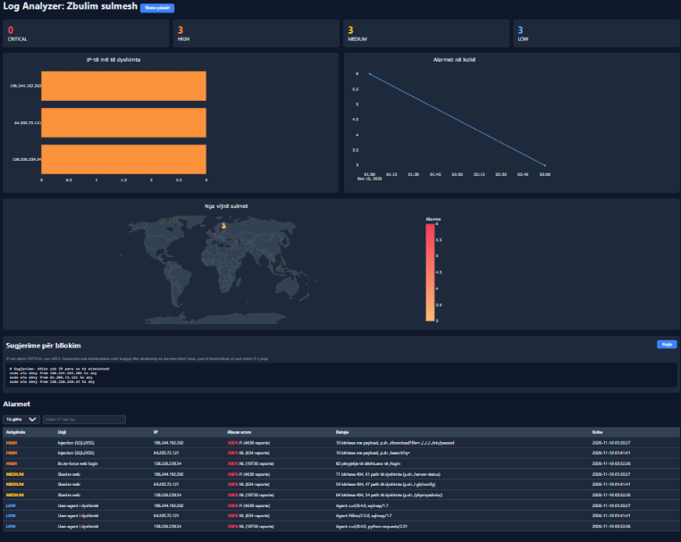

# Log Analyzer: Zbulim sulmesh



Mjet në Python që lexon log-e të serverit (SSH `auth.log` dhe nginx `access.log`), zbulon brute-force, skanime dhe injection, dhe i shfaq alarmet në një dashboard web me reputacionin e IP-ve nga AbuseIPDB, hartën e sulmeve, sugjerime për bllokim dhe njoftime me email.

## Funksionet

- Parsera me regex për SSH dhe nginx, me mbështetje për formatin klasik dhe modern (timestamp ISO, `sshd-session`, IPv6)
- Detektor me rregulla dhe dritare rrëshqitëse për brute-force
- Alarme me ashpërsi CRITICAL, HIGH, MEDIUM, LOW (të ruajtura në SQLite)
- Dashboard me karta, grafikë Plotly dhe tabelë alarmesh
- Filtër sipas ashpërsisë dhe kërkim sipas IP ose llojit
- Reputacioni i IP-ve nga AbuseIPDB (score, vendi, numri i raporteve)
- Hartë botërore me vendet nga vijnë sulmet
- Sugjerime për bllokim IP (`ufw deny from`), vetëm si sugjerim, pa ekzekutim automatik
- Njoftime me email për alarme CRITICAL (një herë për çdo alarm)
- Teste automatike me `pytest` (13 teste për parserat dhe rregullat)
- Testuar me log-e të vërteta nga Ubuntu (WSL)

## Çfarë zbulon

| Sulmi | Rregulli | Ashpërsia |
|---|---|---|
| Brute-force i suksesshëm në SSH | Hyrje e pranuar pas shumë dështimesh nga e njëjta IP | CRITICAL |
| SSH brute-force | 10+ login të dështuar brenda 5 minutash nga një IP | HIGH |
| Injection (SQLi, XSS, path traversal) | Payload të njohura në URL | HIGH |
| Brute-force në login web | 15+ POST të dështuara (401/403) | HIGH |
| Skanim web | 15+ kërkesa 404 ose 5+ path të dyshimta | MEDIUM |
| User-agent i dyshimtë | sqlmap, Nikto, curl, python-requests | LOW |

## Si funksionon

```
auth.log / access.log -> parsers.py -> detector.py -> alerts.db (SQLite) -> app.py (Flask) -> dashboard
                                            |                                    |
                                      notify.py (email)               reputation.py (AbuseIPDB)
```

- `parsers.py`: parsera me regex që i kthejnë rreshtat në ngjarje të strukturuara
- `detector.py`: rregullat e detektimit, ruajtja e alarmeve dhe njoftimet
- `notify.py`: dërgon email me Gmail (SMTP)
- `reputation.py`: kontrollon IP-të te AbuseIPDB
- `app.py`: server Flask me API (`/api/data`, `/api/rescan`)
- `templates/dashboard.html`: dashboard-i
- `generate_logs.py`: gjenerator i log-eve të rreme me sulme brenda, për testim
- `fetch_bad_ips.py`: (opsionale) merr IP të raportuara nga AbuseIPDB për demon
- `tests/`: teste `pytest`

## Instalimi (Windows PowerShell)

```powershell
git clone https://github.com/Orgesa-z/log-analyzer.git
cd log-analyzer
python -m venv venv
venv\Scripts\Activate.ps1
pip install -r requirements.txt
python generate_logs.py
python app.py
```

Pastaj hap http://127.0.0.1:5000

### Teste

```powershell
pip install pytest
python -m pytest -v
```

### Opsionale: reputacion IP me AbuseIPDB

Pa key, dashboard-i punon njësoj, por kolona "Abuse score" shfaq `-` dhe harta del bosh. Merr një key falas te [abuseipdb.com](https://www.abuseipdb.com) dhe vendose si variabël mjedisi (**mos e shkruaj kurrë në kod**):

```powershell
$env:ABUSEIPDB_KEY="key-yt"
python fetch_bad_ips.py
python generate_logs.py
python app.py
```

### Opsionale: njoftime me email

Krijo një App Password në Google (kërkon 2-Step Verification) dhe vendose si variabla mjedisi (fjalëkalimi pa hapësira):

```powershell
$env:GMAIL_USER="emaili-yt@gmail.com"
$env:GMAIL_APP_PASSWORD="fjalekalimi16shkronja"
python app.py
```

Pa to, njoftimet çaktivizohen vetë dhe gjithçka tjetër punon.

## Log-e të vërteta

Vendosi në `logs/auth.log` dhe `logs/access.log` dhe kliko "Skano përsëri" në dashboard. Mbështeten formati klasik syslog dhe ai modern i Ubuntu (timestamp ISO, `sshd-session`, IPv6). Për një dosje tjetër:

```powershell
python -c "import detector; detector.run('logs_real')"
```

## Shënim

Log-et e demos janë të gjeneruara. Përdore vetëm në sisteme të tuat. Komandat e bllokimit nuk ekzekutohen vetë; kontrollo çdo IP para se t'i përdorësh.

## Idetë për të ardhmen

- Lexim i log-eve në kohë reale (tail)
- Mbështetje për `journalctl`
